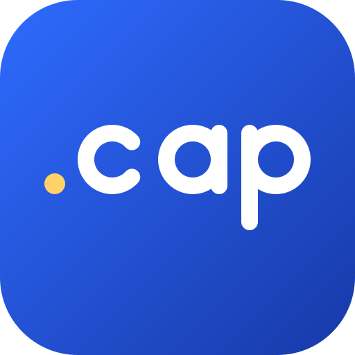
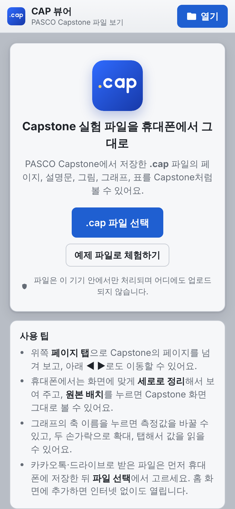
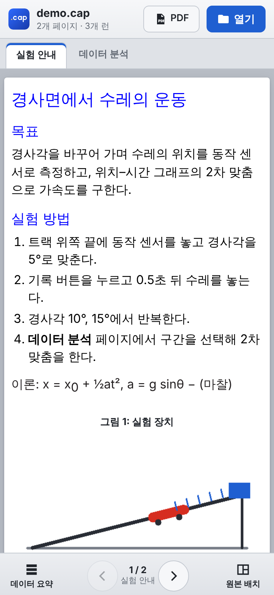
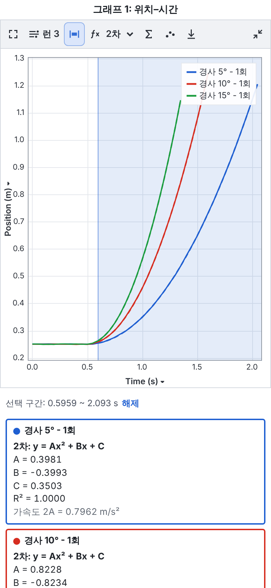
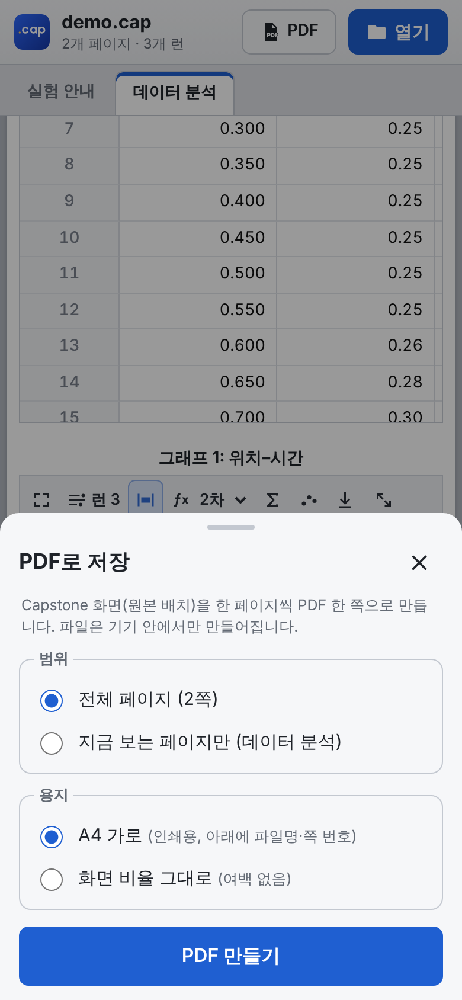
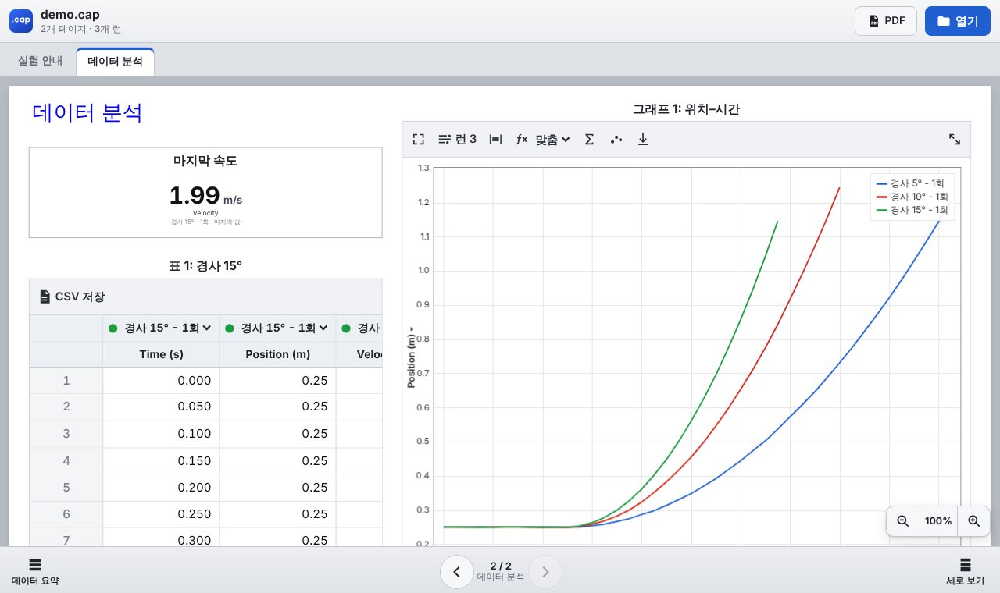
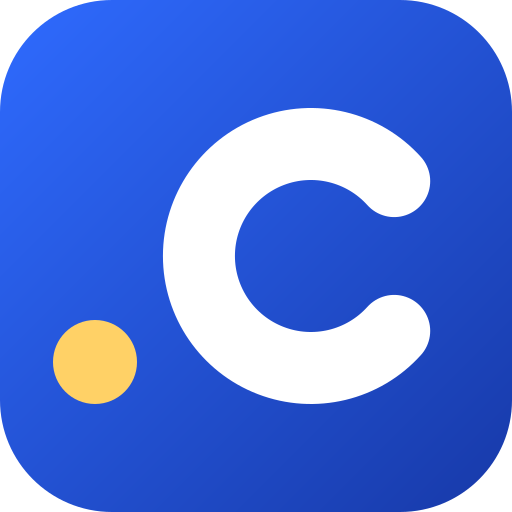

<p align="center">
  
</p>

<h1 align="center">CAP 뷰어</h1>

<p align="center">
  <b>PASCO Capstone 실험 파일(.cap)을 휴대폰에서 그대로</b><br>
  페이지 · 설명문 · 그래프 · 표 · PDF 저장 — 설치 없이, 파일은 기기 안에서만
</p>

<p align="center">
  <a href="https://250058.github.io/Cap-viewer/"><b>▶ 앱 열기</b></a>
  &nbsp;·&nbsp; <a href="#휴대폰에-설치하기">홈 화면에 설치</a>
  &nbsp;·&nbsp; <a href="#자주-묻는-질문">자주 묻는 질문</a>
  &nbsp;·&nbsp; <a href="#직접-배포하기">직접 배포하기</a>
</p>

<p align="center">
  
  
  
  
</p>

실험실 컴퓨터에서 Capstone으로 저장한 `.cap` 파일, 집이나 이동 중에 열어 보기 어려우셨죠?
CAP 뷰어는 휴대폰 브라우저에서 `.cap` 파일을 열어 **Capstone 화면처럼** 페이지를 넘겨 보고,
그래프를 분석하고, 보고서용 **PDF**와 **CSV**로 저장할 수 있는 웹앱입니다.

- 📱 **설치 없이 바로**: 링크만 열면 끝. 홈 화면에 추가하면 앱처럼, 인터넷 없이도 동작
- 🔒 **파일은 내 기기 안에서만**: 서버로 올라가지 않고, 로그인도 광고도 없음
- 🖥️ **Capstone 그대로**: 페이지 탭, 설명문, 그림, 그래프, 표, 숫자 표시, 답 입력란
- 📈 **분석까지**: 구간 선택, 직선·2차 맞춤, 통계, 측정값·런 바꾸기
- 📄 **PDF·CSV 저장**: 모든 페이지를 한 번에 PDF로, 데이터는 엑셀용 CSV로

> PASCO scientific의 공식 앱이 아니며 PASCO와 관련이 없습니다. "PASCO", "Capstone"은 PASCO scientific의 상표입니다.

## 바로 시작하기

1. 휴대폰에서 **[앱 열기](https://250058.github.io/Cap-viewer/)** 를 누릅니다.
2. **.cap 파일 선택**을 누르고 기기에 저장된 `.cap` 파일을 고릅니다.
   - 카카오톡·드라이브로 받은 파일은 먼저 휴대폰에 **저장**한 뒤 고르세요.
   - 파일이 없다면 **예제 파일로 체험하기**를 눌러 보세요.
3. 위쪽 **페이지 탭**이나 아래 **◀ ▶** 로 페이지를 넘겨 봅니다.

## 주요 기능

### Capstone 화면 그대로

- Capstone 워크북의 **페이지 탭**과 페이지 순서를 그대로 보여 주고, 저장할 때 보던 페이지부터 열립니다.
- 페이지 안의 **설명문**(글꼴 크기·색·굵게·아래첨자·표·목록), **그림**, **답 입력란**, **그래프**, **표**, **숫자 표시**를 보여 줍니다.
- 보기 방식 두 가지 (오른쪽 아래 버튼, 선택은 기억됩니다)
  - **세로 보기**: 휴대폰 화면에 맞게 읽는 순서대로 세로로 정리 (휴대폰 기본)
  - **원본 배치**: Capstone에서 배치한 위치·크기 그대로, 확대/축소 가능 (태블릿·PC 기본)

<p align="center">
  
</p>

### 그래프 분석

- 축 이름(예: `Position (m) ▾`)을 눌러 측정값 바꾸기, **런 선택**으로 여러 런 겹쳐 보기
- 한 손가락으로 이동, 두 손가락으로 확대/축소(가로·세로 따로), 탭해서 좌표 읽기, 두 번 탭해서 전체 보기
- **구간 선택** → **직선 맞춤**(기울기·절편·R²) / **2차 맞춤**(A·B·C·R², 위치–시간 그래프면 가속도 2A)
- **Σ 통계**: 평균·최소·최대·표준편차·개수
- 점/선 표시 바꾸기, 그래프 이미지(PNG) 저장, **크게 보기**(전체 화면, 뒤로 가기로 닫힘)

### 표와 데이터

- Capstone 표처럼 열마다 런 선택, 행 번호, 표마다 **CSV 저장**
- 센서로 측정한 값뿐 아니라 **표에 직접 입력한 값**과 **계산기 계산값**(사칙연산·거듭제곱·단위 변환으로 된 식)도 표시
- 파일에 정해 둔 **표시 단위**로 보여 줌 (예: V → mV, A → mA)
- 아래 **데이터 요약**: 측정값별·런별 목록, 기록 시각, 센서 정보, 런 전체 데이터 표, **전체 런 CSV**(엑셀에서 한글이 깨지지 않음)

### PDF로 저장

- 위쪽 **PDF** 버튼 → 모든 페이지(또는 지금 보는 페이지)를 **Capstone 원본 배치 그대로** 한 쪽씩 PDF로
- 용지: **A4 가로**(인쇄용, 아래에 파일명·페이지 이름·쪽 번호) 또는 **화면 비율 그대로**
- PDF **책갈피(목차)** 에 페이지 이름이 들어가 바로 이동 가능
- 칸보다 긴 설명문은 잘리지 않도록 글자를 줄여 맞추고, 그래프 위 도구 모음은 빼고 저장
- 지원하는 휴대폰에서는 **공유**로 카카오톡 등에 바로 보내기

### 오프라인·설치·공유

- 한 번 열어 두면 **인터넷 없이도** 동작 (PDF 저장 포함)
- Android에서 앱으로 설치하면 파일 앱·메신저의 **공유 → CAP 뷰어**로 바로 열기
- 라이트/다크 모드 자동 (페이지는 Capstone처럼 항상 흰 종이)

## 휴대폰에 설치하기

설치하지 않아도 쓸 수 있지만, 홈 화면에 추가하면 앱처럼 전체 화면으로 열리고 오프라인에서도 바로 실행됩니다.

| 기기 | 방법 |
| --- | --- |
| **Android** (Chrome, 삼성 인터넷) | 메뉴 **⋮** → **앱 설치** 또는 **홈 화면에 추가** |
| **iPhone·iPad** (Safari) | 아래 **공유** 버튼 → **홈 화면에 추가** |
| **PC** (Chrome, Edge) | 주소창 오른쪽의 **설치** 아이콘 |

## 개인정보

- `.cap` 파일은 **브라우저 안에서만** 읽고 처리합니다. 어떤 서버로도 전송하지 않습니다.
- 외부 분석 도구, 광고, 쿠키, 로그인이 없습니다.
- 기기에 남는 것: 앱 파일(오프라인 실행용 캐시)과 "보기 방식" 설정 하나뿐입니다. 공유로 받은 파일은 열자마자 임시 저장소에서 지웁니다.

## 지원 범위

| | 내용 |
| --- | --- |
| ✅ 지원 | 센서 측정값, 표에 입력한 값, 계산값(사칙연산·거듭제곱·단위 변환), 텍스트·답 입력란·그림·그래프·표·숫자 표시 |
| ⚠️ 일부 | 단위 코드: 확인된 것만 표시(s, m, m/s, m/s², V, mV, A, mA, T, C, kg, 사용자 지정). 모르는 단위는 비워 둠 |
| ❌ 미지원 | 미터·오실로스코프·FFT·동영상 디스플레이(자리 표시만), 함수(sin, sqrt 등)가 들어간 계산식 |

브라우저: 최신 **Chrome·삼성 인터넷·Edge**(Android/PC), **Safari**(iOS 14 이상). 자동 테스트는 Chromium에서 합니다.

## 자주 묻는 질문

**파일 선택 창에 .cap 파일이 안 보여요.**
카카오톡·메일·드라이브에서 받은 파일은 앱 안에 있을 수 있습니다. 먼저 "저장"이나 "다운로드"로 기기(파일 앱/내 파일)에 저장한 뒤 다시 고르세요.

**"main.xml 이 없습니다" / "ZIP 형식이 아닙니다"가 나와요.**
Capstone에서 저장한 `.cap` 파일이 아니거나, 전송 중에 파일이 손상된 경우입니다. 원본 파일을 다시 받아 보세요.

**그래프·표에 단위가 비어 있어요. / 계산값이 안 보여요.**
아직 확인하지 못한 단위 코드이거나 지원하지 않는 함수가 들어간 계산식입니다. 저장소 이슈에 파일을 올려 주시면 지원을 추가할 수 있습니다.

**PDF 글자를 선택·검색할 수 없어요.**
PDF는 화면을 그대로 담은 이미지로 만들어서 글자를 선택할 수 없습니다. 데이터가 필요하면 CSV 저장을 이용하세요.

**업데이트한 내용이 안 보여요.**
오프라인용 캐시 때문입니다. 새 버전은 열 때 뒤에서 받아 두었다가 그다음 실행부터 적용됩니다. 앱(탭)을 닫았다가 다시 열어 보세요 (필요하면 한 번 더).

## 직접 배포하기

빌드 과정이 없는 정적 웹앱이라, 저장소를 그대로 올리기만 하면 됩니다.

**GitHub Pages**
1. 저장소 **Settings → Pages**
2. **Build and deployment → Source: Deploy from a branch**
3. 배포할 브랜치(예: `main`)와 폴더 **`/ (root)`** 를 고르고 **Save**
4. 1~2분 뒤 `https://<사용자이름>.github.io/<저장소이름>/` 에서 열립니다.

**배포 전 확인할 것**
- **HTTPS**로 제공해야 설치·오프라인·공유 기능이 동작합니다 (GitHub Pages, Netlify, Cloudflare Pages 등은 기본이 HTTPS).
- 주소가 위와 다르면 `index.html`의 `og:image`(링크 미리보기 이미지) 주소와 이 README의 **앱 열기** 링크를 바꿔 주세요.
- 앱 파일을 고친 뒤 다시 배포할 때는 `sw.js`의 `VERSION` 값을 올려야 사용자 기기의 캐시가 새 버전으로 바뀝니다.

## 아이콘

<p>
  
  
</p>

파일 확장자에서 따온 **`.cap`** 소문자를 원과 직선만으로 그린 전용 모노라인 글자입니다.
글꼴 없이 도형으로 그려서 어느 기기에서나 똑같이 보이고, 노란 점은 마침표이자 그래프의 데이터 점입니다.
16~32px처럼 작은 곳(브라우저 탭)에서는 같은 규칙으로 그린 **`.c`** 를 씁니다.

| 파일 | 용도 |
| --- | --- |
| `icons/icon.svg` | 원본 (앱 아이콘) |
| `icons/favicon.svg`, `favicon-32.png` | 브라우저 탭 |
| `icons/icon-192.png`, `icon-512.png` | 설치 아이콘 |
| `icons/icon-maskable-512.png` | Android 적응형 아이콘 (가장자리까지 채운 배경) |
| `icons/icon-monochrome-512.png` | 단색 아이콘 |
| `icons/apple-touch-icon.png` | iPhone·iPad 홈 화면 |
| `icons/og-image.png` | 링크 미리보기 (카카오톡·메신저·SNS) |

색: 배경 `#2f6bff` → `#1739a8` 그라데이션, 글자 `#ffffff`, 점 `#ffd166`.
PNG는 `node tools/render-icons.mjs`로 SVG에서 다시 만들 수 있습니다.

## 개발자용

```
index.html              화면
css/style.css           스타일 (Capstone 스타일 틀, 라이트/다크)
js/zip.js               ZIP 읽기 + inflate (DecompressionStream, 없으면 순수 JS)
js/cap.js               .cap 해석 (main.xml, 데이터, 입력값, 계산식, 워크북 페이지)
js/richtext.js          Capstone(Qt) 서식 텍스트를 안전한 HTML로 (허용 목록 방식)
js/util.js              숫자 형식, 통계/맞춤, 아이콘
js/chart.js             터치 제스처를 지원하는 캔버스 그래프
js/widgets.js           페이지 디스플레이: 텍스트, 답 입력란, 그림, 그래프, 표, 숫자
js/pdf.js               PDF 작성 (페이지 이미지 + 책갈피, 의존성 없음)
js/app.js               화면 틀: 페이지 탭, 보기 방식, 데이터 요약, 런 선택, CSV, PDF
sw.js                   오프라인 캐시 + Android 공유 받기
manifest.webmanifest    앱 설치 정보
vendor/                 html2canvas 1.4.1 (페이지 → 이미지, MIT, 원본 그대로)
examples/demo.cap       예제 파일 (합성 데이터)
docs/cap-format.md      .cap 파일 구조 분석 메모
tools/                  예제 파일·아이콘 생성 스크립트
tests/e2e.mjs           헤드리스 Chromium 종단 테스트
```

```bash
# 로컬에서 실행 (서비스 워커 때문에 file:// 대신 서버로)
python3 -m http.server 8000          # → http://localhost:8000

# 테스트 (Playwright 필요: npm i -D playwright && npx playwright install chromium)
node tests/e2e.mjs                   # 예제 파일로 전체 기능 검사 (PDF 포함)
node tests/e2e.mjs 내파일.cap         # 내 파일의 모든 페이지를 휴대폰·PC 폭으로 열어 검사

# 예제 파일 / 아이콘 다시 만들기
python3 tools/make_demo_cap.py examples/demo.cap
node tools/render-icons.mjs
```

`.cap` 파일 형식은 [docs/cap-format.md](docs/cap-format.md)에 정리해 두었습니다.

## 라이선스

- 이 저장소의 라이선스는 아직 정하지 않았습니다. 다른 사람이 자유롭게 쓰고 고치게 하려면 `LICENSE` 파일(예: MIT)을 추가하세요.
- 함께 들어 있는 [html2canvas](https://github.com/niklasvh/html2canvas) 1.4.1은 MIT 라이선스입니다 (`vendor/html2canvas.LICENSE`).
